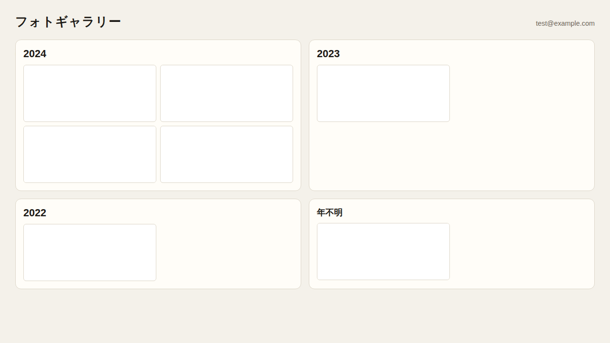
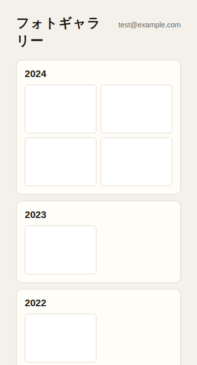
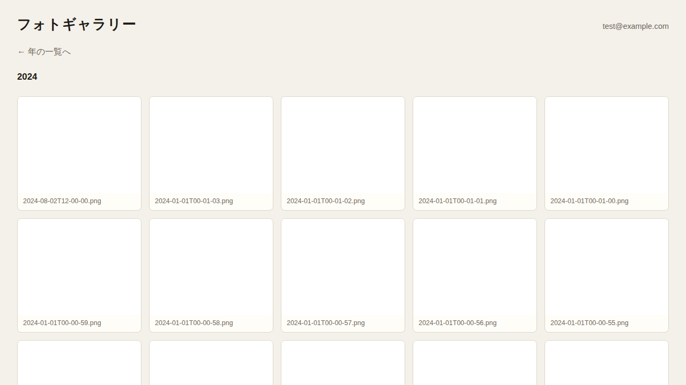
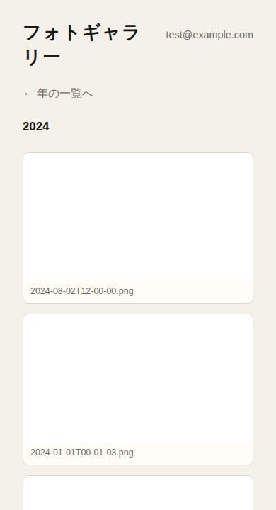
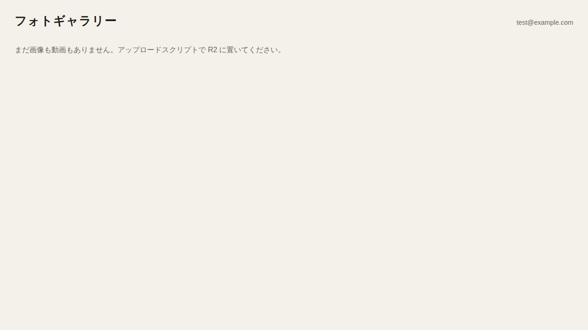
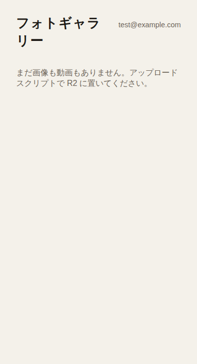
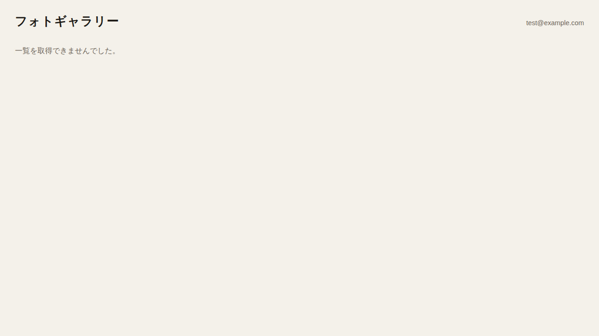
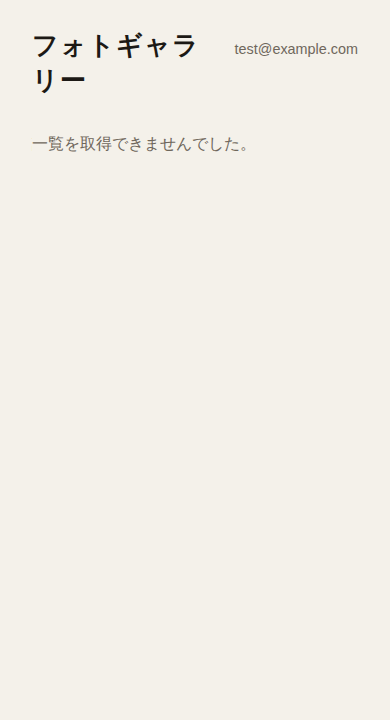
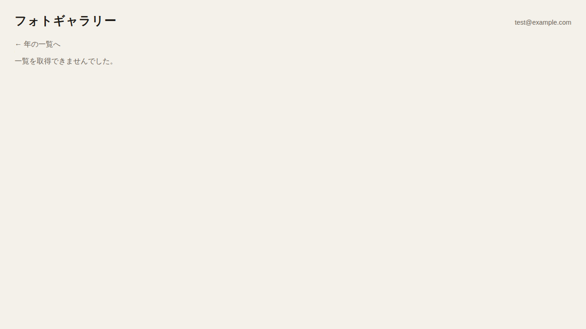
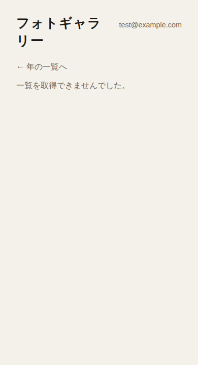

# UC-01 ギャラリーを見る

用語は [GLOSSARY.md](../../GLOSSARY.md)。

- ID: UC-01
- Name: ギャラリーを見る
- Primary actor: User
- Preconditions: None
- Related: 年の決め方は R-MEDIA-02。並び順は R-GAL-01。一覧の上限は R-GAL-02。一覧 API の形は R-GAL-03。年の一覧のプレビューは R-GAL-10。検索結果に出さないことは R-GAL-09。ログインメールがないローカルプレビューは [UC-L-01](../spec-local/UC-L-01-ローカルでギャラリーを見る.md)。
- Postconditions (success):
  - タブにタブの印が出る。
  - 見出しの横のログインメールアドレスで、`<`、`>`、`&`、`'`、`"` は文字どおり出る。
  - 見出しの横は `test@example.com`。メディアがある年はラベルと最大 4 枚のサムネイル付きのカードになり、「年不明」は最後。拡大表示は開いていない。

    | PC                                                 | スマホ                                                     |
    | -------------------------------------------------- | ---------------------------------------------------------- |
    |  |  |

  - 利用者が年の一覧から年を開くと、URL にその年が入る。
  - 2024 の年の画面。その年のタイルだけが出ている。

    | PC                                                        | スマホ                                                            |
    | --------------------------------------------------------- | ----------------------------------------------------------------- |
    |  |  |

  - サムネイルは拡大表示を選べる。
  - アクセシブルネームは本体の名前である。
  - 一覧の上限で年が打ち切られているとき、年の見出しの横に「（上限で打ち切っています）」が出る。「N 件」は出ない。
  - 年の画面のタイルがビューポートの下端に届かないとき、その年のタイルがさらに出る。利用者はスクロールしない。
  - さらに出たあとに、その年の未表示があれば、タイルの数は増えている。
  - その年を出し切ったあとは、ほかの年は読み込まない。
  - 利用者が年の画面から年の一覧へ戻ると、年を開く前のスクロール位置に戻る。
  - URL に年がすでに入っていて、その年にメディアがあるとき、再読み込み後もその年の画面が出る。
  - 画像も動画もないとき。「まだ画像も動画もありません。アップロードスクリプトで R2 に置いてください。」が出る。

    | PC                                             | スマホ                                                 |
    | ---------------------------------------------- | ------------------------------------------------------ |
    |  |  |

- Postconditions (failure):
  - 年の一覧を取得できないとき。「一覧を取得できませんでした。」が出る。年のカードは出ない。

    | PC                                                             | スマホ                                                                 |
    | -------------------------------------------------------------- | ---------------------------------------------------------------------- |
    |  |  |

  - 年の画面の一覧を取得できないとき。「一覧を取得できませんでした。」が出る。タイルは出ない。

    | PC                                                             | スマホ                                                                 |
    | -------------------------------------------------------------- | ---------------------------------------------------------------------- |
    |  |  |

### Flow

1. 利用者が URL に年がない状態でギャラリーを開く。
   - 1a. URL に年がすでに入っている。
     1. 手順 2 から 5 のあと、ブラウザは手順 12 の年の画面を開く。
2. ブラウザはタブの題を「フォトギャラリー」にする。
3. ブラウザは見出しを「フォトギャラリー」にする。
4. ブラウザは見出しの横のログイン表示に、ログインメールアドレスを出す。
5. ブラウザはタブにタブの印を付ける。
6. ブラウザは「読み込み中です。」を出す。
7. ブラウザは R-GAL-03 の形で年の一覧を取得する。
   - 7a. どの年にも「年不明」にもメディアがない。
     1. ブラウザは「読み込み中です。」を隠す。
     2. ブラウザは「まだ画像も動画もありません。アップロードスクリプトで R2 に置いてください。」を出す。
   - 7e. 年の一覧を取得できない。
     1. ブラウザは「読み込み中です。」を隠す。
     2. ブラウザは「一覧を取得できませんでした。」を出す。
8. ブラウザは「読み込み中です。」を隠す。
9. ブラウザは年の一覧を出す。各年のカードは、R-GAL-10 に従い年のラベルと最大 4 枚のサムネイルを出す。「年不明」があるときは最後に出す。
10. 利用者が、年またはその年のカード上のサムネイルを選ぶ。
11. ブラウザはその年を URL に入れ、年の画面を開く。
12. ブラウザは「読み込み中です。」を出す。
13. ブラウザは R-GAL-03 の形でその年の一覧を取得する。
    - 13e. 一覧を取得できない。
      1. ブラウザは「読み込み中です。」を隠す。
      2. ブラウザは「一覧を取得できませんでした。」を出す。
14. ブラウザは「読み込み中です。」を隠す。
15. ブラウザはリンク「← 年の一覧へ」と年の見出しを出す。R-GAL-02 で年が打ち切られているとき、見出しのあとに「（上限で打ち切っています）」が続く。
16. ブラウザはその年のメディアを R-GAL-01 の順のタイルとして出す。サムネイルが出る。アクセシブルネームは本体の名前である。
    - 16a. タイルがビューポートの下端に届かない。
      1. ブラウザは、利用者がスクロールせずに、その年の続きを出す。
17. 利用者がビューポートの下端までスクロールする。
    - 17a. その年のタイルに未表示がある。
      1. ブラウザはその年のタイルをさらに出す。
18. 利用者が「← 年の一覧へ」を選ぶか、ブラウザの戻る操作をする。
19. ブラウザは、手順 10 の前のスクロール位置で年の一覧を出す。
