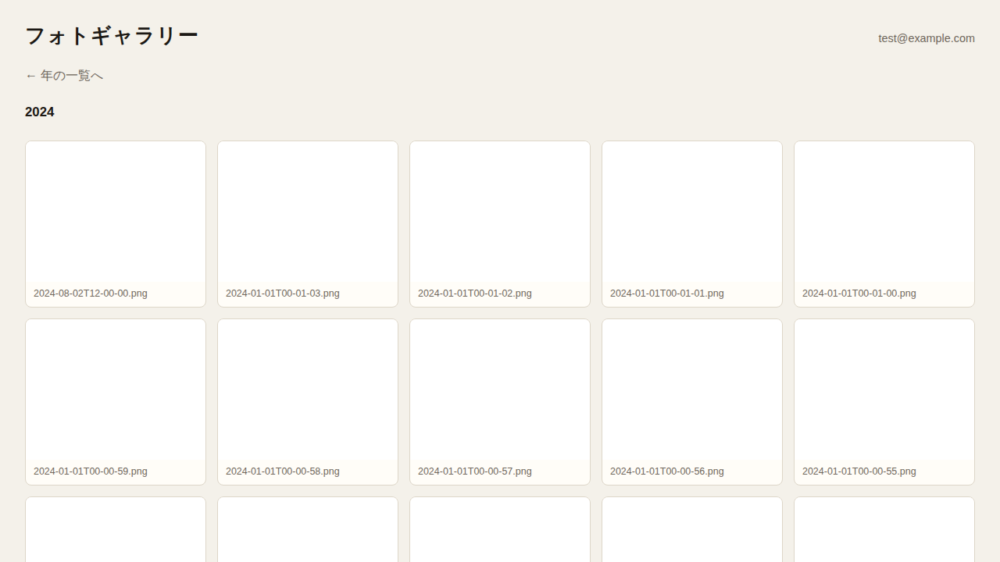
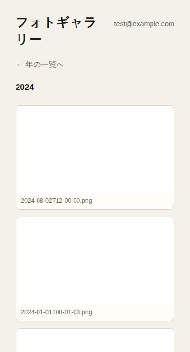
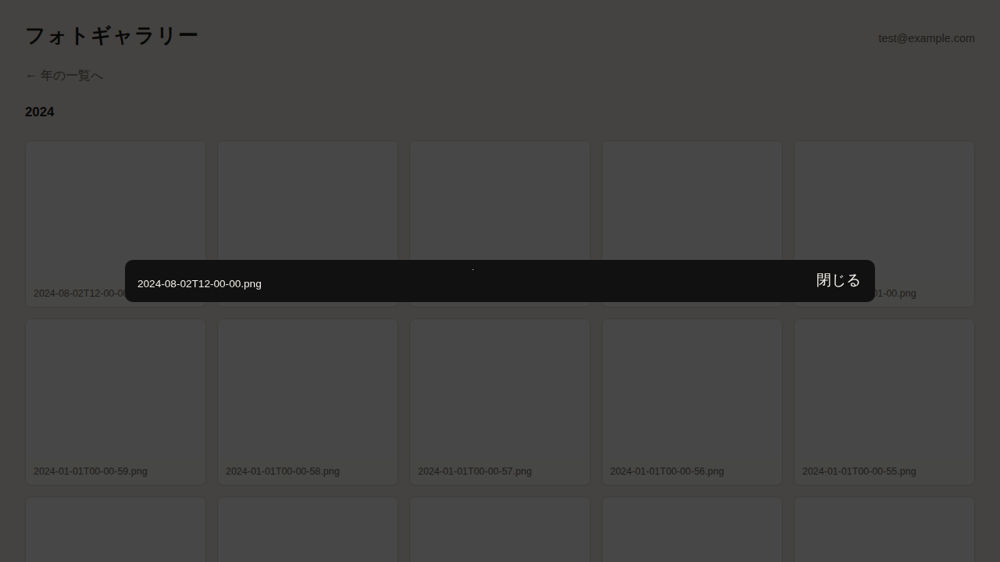
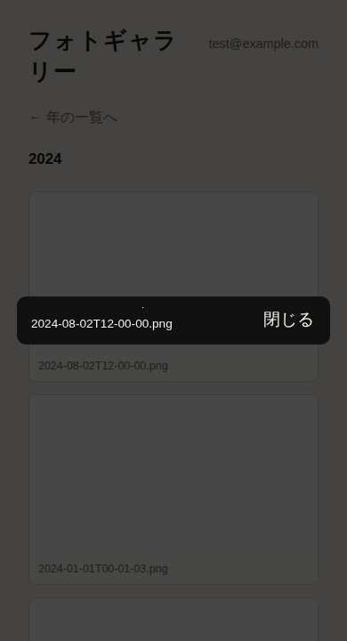
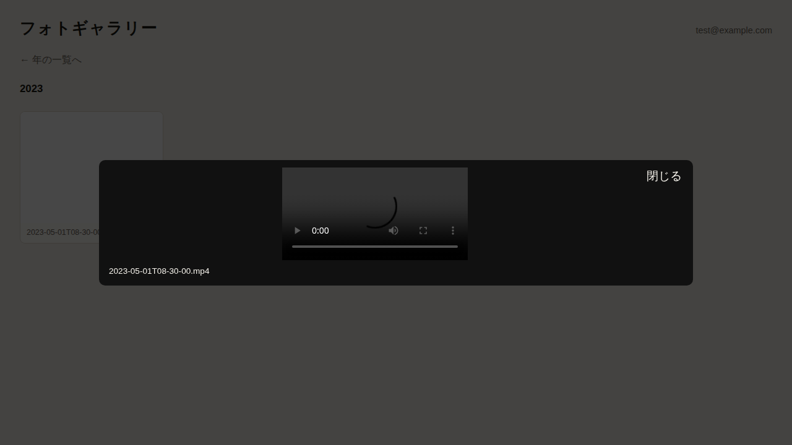
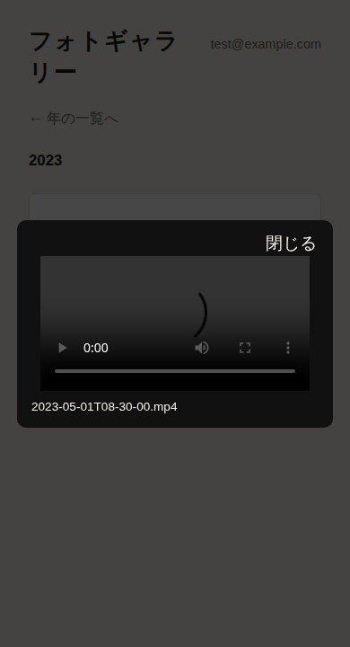
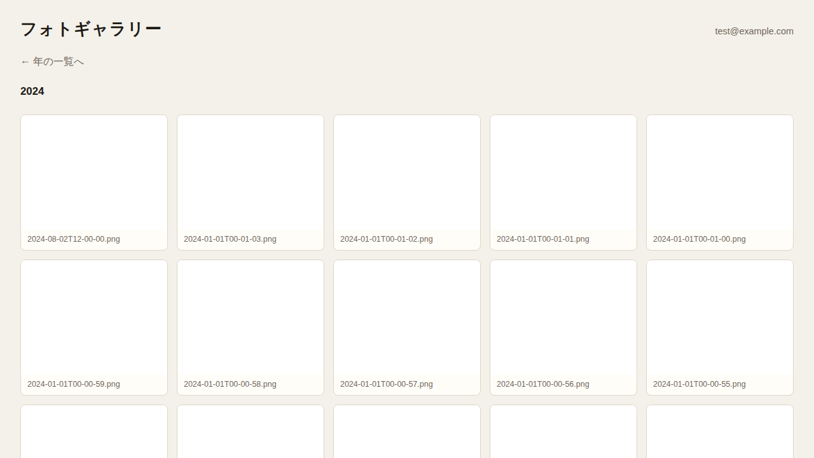
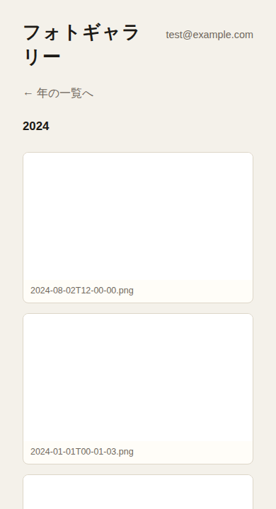

# UC-02 拡大して見る

用語は [GLOSSARY.md](../../GLOSSARY.md)。

- ID: UC-02
- Name: 拡大して見る
- Primary actor: User
- Preconditions: 年の画面にサムネイルが 1 枚以上出ている。

  | PC                                                   | スマホ                                                       |
  | ---------------------------------------------------- | ------------------------------------------------------------ |
  |  |  |

- Related: 配信は R-GAL-04。HEIC と HEIF の配信は R-GAL-06。
- Postconditions (success):
  - 拡大表示に本体が出る。本体の名前が出る。「閉じる」が出る。

    | PC                                                          | スマホ                                                              |
    | ----------------------------------------------------------- | ------------------------------------------------------------------- |
    |  |  |

  - 選んだメディアが動画のとき、自動再生が付き、再生操作が付く。

    | PC                                                          | スマホ                                                              |
    | ----------------------------------------------------------- | ------------------------------------------------------------------- |
    |  |  |

  - 利用者が「閉じる」を選んだあと、拡大表示は消える。タイルは残る。

    | PC                                                       | スマホ                                                           |
    | -------------------------------------------------------- | ---------------------------------------------------------------- |
    |  |  |

- Postconditions (failure): None

### Flow

1. 利用者がサムネイルを選ぶ。
2. ブラウザは拡大表示に本体を出す。
   - 2a. 選んだメディアが動画である。
     1. ブラウザは自動再生を付ける。
     2. ブラウザは再生操作を付ける。
3. ブラウザは本体の名前を出す。
4. ブラウザは「閉じる」を出す。
   - 4a. 利用者が「閉じる」を選ぶ。
     1. ブラウザは拡大表示を隠す。
